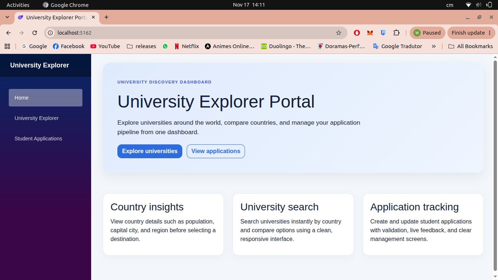
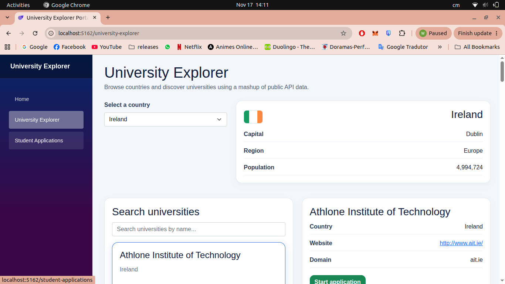
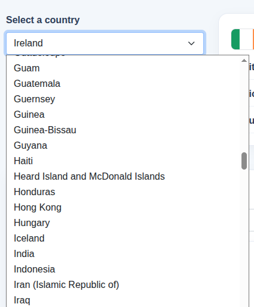
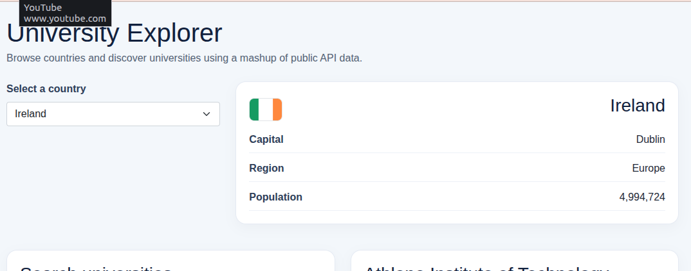
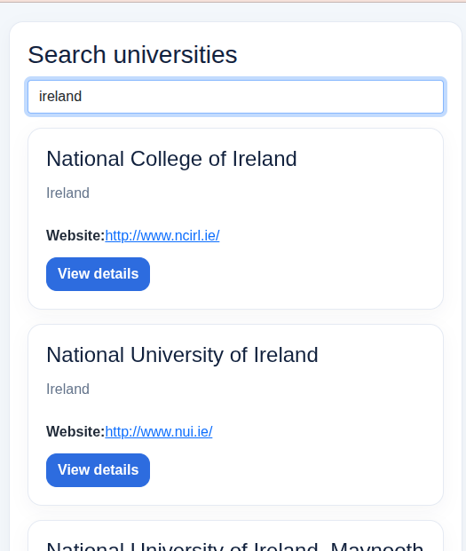
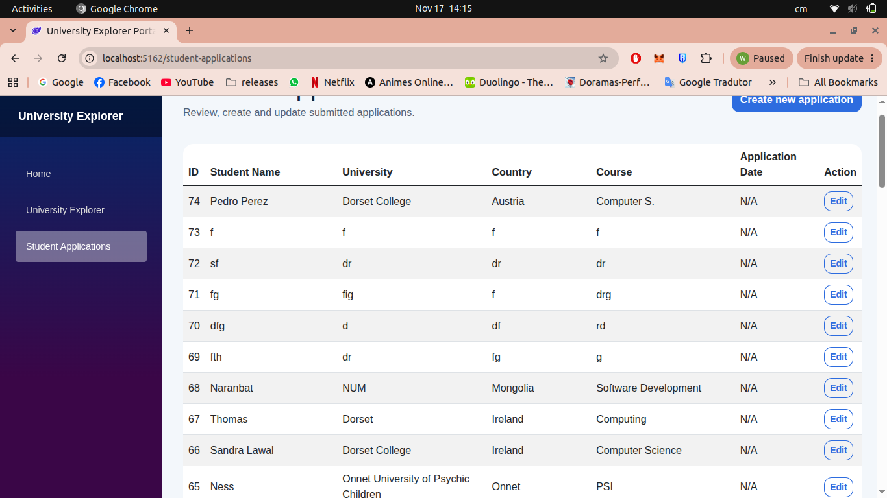
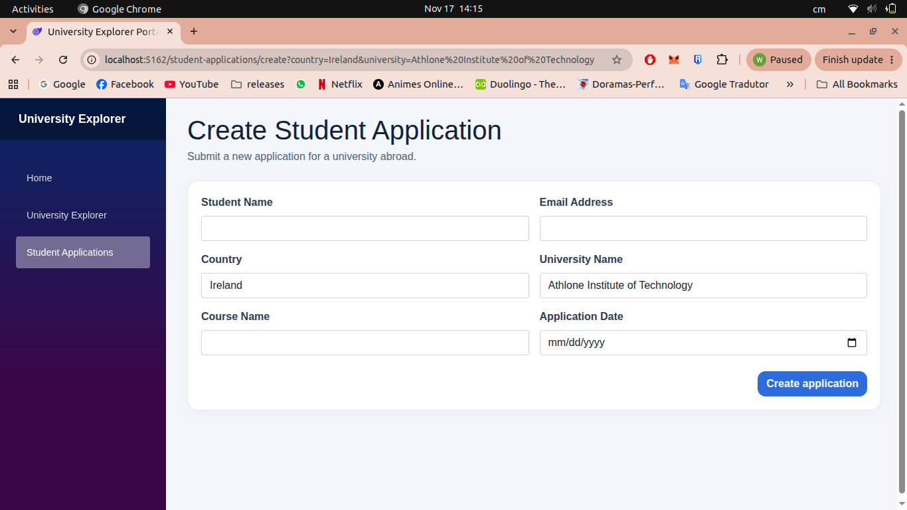
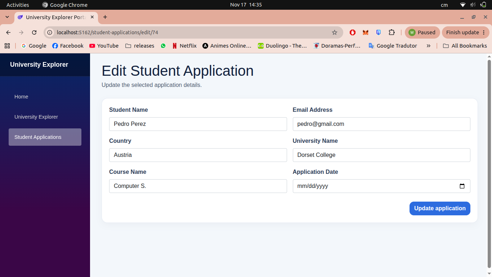

# University Explorer Portal

A Blazor Web App that combines public country and university APIs with the Edutots student application API.

## Features

- Browse countries from the Countries API and view population, capital, and region.
- Search universities by country using the Universities API.
- View university details and start a student application from a selected university.
- Create and update student applications using `EditForm`, validation, and HTTP requests.
- Manage application state with a reusable form component and clean service layer.

## Project structure

- `Models/` – API response and domain models
- `Services/` – REST client services for country, university, and application APIs
- `Components/` – Razor components for cards, details, and the reusable application form
- `Components/Pages/` – page-level routing and UI screens
- `Program.cs` – dependency injection and HttpClient setup

## API notes

The app uses the live public APIs as requested:

- Countries API: `https://countries.dev/countries`
- Universities API: `http://universities.hipolabs.com/search?country={country}`
- Edutots API: `https://edutots.net/api/studentapplication`

The country API may reject requests that do not include a browser-like `User-Agent`, so the app sets a simple Mozilla header in `Program.cs`.

## Run locally

```bash
export PATH="$HOME/.dotnet:$PATH"
cd UniversityExplorerPortal
~/.dotnet/dotnet run
```

Then open the local URL shown by the console, typically `http://localhost:5000` or another port chosen by ASP.NET Core.

## Screenshots

### Home page


### University Explorer page


### Country selected and details displayed




### University search


### University details displayed
The details panel on the right of the University Explorer screenshot above shows the selected university (name, country, website and domain).

### Student Applications page (GET)


### Create Student Application page (POST)


### Edit Application page (PUT)

